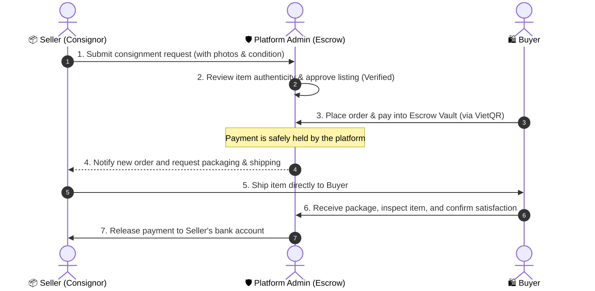

# 🏛️ AURA VAULT — Certified Luxury Consignment & Trading Platform

> **A trusted platform for trading and consigning high-end luxury goods.**  
> Built with multi-layer expert authentication, a secure payment escrow system (**Aura Escrow Vault**), and a minimalist Quiet Luxury design.

---

## 📖 1. Project Overview

The secondary luxury market faces two major challenges: **counterfeit goods** and **payment fraud**.

**Aura Vault** solves these problems with three core pillars:
- **100% Verified Authenticity**: Every consigned item must be reviewed and approved by administrators/experts before it is published.
- **Aura Escrow Vault**: Buyer payments are safely held in an escrow account. Funds are released to the seller only after the buyer receives the item and confirms satisfaction.
- **Quiet Luxury Experience**: Clean, minimalist interface designed with high-quality photography and elegant typography (no bright, distracting emojis).

---

## 🔄 2. Transaction & Escrow Workflow



---

## ✨ 3. Key Features by Role

### 🛍️ For Buyers
- **Explore & Filter**: Browse curated collections with clean photos, filter by categories, and search brands (Rolex, Chanel, Cartier, etc.).
- **Item Dossier (Product Details)**:
  - Multi-angle studio photo gallery.
  - Inspection specifications with frosted-glass condition tags (*Brand New 100%, Like New 99%, Excellent 97%*).
  - Trust promises: 100% Expert Inspection, Escrow Protection, Full Shipping Insurance.
- **Automated VietQR Payment**: Scan dynamic bank QR codes with exact amount and order reference for secure checkout.
- **Order Tracking (My Orders)**: Real-time order progress (*Pending Payment, Paid / In Escrow, Shipping, Completed, Cancelled*).

### 📦 For Consignors (Sellers)
- **Easy Consignment Form**: Upload up to 5 detailed photo links, choose item condition grade, and automatically register new luxury brands.
- **Status Tracking**: Clear visibility on your submissions (*Pending Approval, Active, Sold, Rejected*).
- **Incoming Orders Management**: Review orders placed by buyers for your items and fulfill delivery.

### 🛡️ For Administrators (Admin Concierge)
- **Item Inspection & Moderation**: Inspect submitted listings, approve items for sale, or reject with custom feedback.
- **Order & Escrow Management**: Update order statuses, confirm buyer payments, and authorize seller payouts.
- **User Management**: Lock or unlock accounts violating marketplace policies.
- **Dashboard & Analytics**: Track total platform revenue, active inventory, and total registered users.

---

## 🛠️ 4. Tech Stack

| Layer | Technologies | Description |
| :--- | :--- | :--- |
| **Frontend** | React 19, Vite, Tailwind CSS v4, React Router v7 | Fast Single Page Application (SPA) with responsive design |
| **HTTP & State** | Axios, Custom Hooks (`useAuth`, `useCart`, `useListings`) | RESTful API communication and state management |
| **Icons & Style** | Lucide / Thin Vector SVG Icons | Elegant Quiet Luxury style with zero clutter |
| **Backend** | Node.js, Express.js 5 (ES Modules) | Scalable REST API for user, listing, and order management |
| **Database** | MySQL Server (`mysql2/promise`) | Relational database with connection pooling for high performance |
| **Security & Auth** | JWT (JSON Web Tokens), Bcrypt, Express Rate Limit | Password hashing, protected endpoints, and rate limiting |

---

## 📂 5. Project Structure

This project follows a clean, modular architecture:

```
luxury_platform/
├── backend/
│   ├── src/
│   │   ├── config/
│   │   │   └── db.js                        # MySQL connection pool configuration
│   │   ├── controller/
│   │   │   ├── User_controller.js           # Authentication & user profile handlers
│   │   │   ├── Listings_controller.js       # Listing creation, filtering & approval
│   │   │   ├── Cart_controller.js           # User shopping cart operations
│   │   │   └── orderController.js           # Order creation & Escrow payment handling
│   │   ├── middlwares/
│   │   │   ├── authmiddlware.js             # JWT verification & admin authorization
│   │   │   └── rateLimiter.js               # Brute-force & DDoS rate limiting
│   │   ├── routes/
│   │   │   ├── userRoutes.js                # Auth & user API routes
│   │   │   ├── listingRoutes.js             # Listing & consignment API routes
│   │   │   ├── cartRoutes.js                # Cart API routes
│   │   │   └── orderRoutes.js               # Order API routes
│   │   ├── services/
│   │   │   ├── User_services.js             # Database queries for users
│   │   │   ├── Listings_services.js         # Database queries for listings & categories
│   │   │   ├── Cart_services.js             # Database queries for shopping cart
│   │   │   └── Order_services.js            # Database queries for orders & escrow
│   │   └── server.js                        # Express server entry point
│   ├── .env.example                         # Example environment variables
│   ├── .env                                 # Backend environment variables
│   └── package.json
│
├── database/
│   └── schema_and_sample_data.sql           # Database schema & sample seed data
│
├── frontend/
│   ├── public/                              # Static public assets
│   ├── src/
│   │   ├── components/
│   │   │   ├── Navbar.jsx                   # Navigation bar with cart badge
│   │   │   ├── Footer.jsx                   # Minimalist footer component
│   │   │   ├── BannerSlider.jsx             # Auto-rotating hero banner slider
│   │   │   ├── ProductCard.jsx              # Product card with frosted condition tag
│   │   │   └── ConditionBadge.jsx           # Condition rating tag component
│   │   ├── hooks/
│   │   │   ├── useAuth.js                   # Authentication state hook
│   │   │   ├── useCart.js                   # Cart management hook
│   │   │   ├── useListings.js               # Product listings & filters hook
│   │   │   └── useClickOutside.js           # Click-outside dropdown handler hook
│   │   ├── pages/
│   │   │   ├── public/
│   │   │   │   ├── homePage.jsx             # Platform landing home page
│   │   │   │   ├── shopPage.jsx             # Catalog & filtering shop page
│   │   │   │   └── productDetailPage.jsx    # Item details dossier page
│   │   │   ├── auth/
│   │   │   │   ├── loginPage.jsx            # User login page
│   │   │   │   └── registerPage.jsx         # User registration page
│   │   │   ├── user/
│   │   │   │   ├── cartPage.jsx             # Cart & checkout page
│   │   │   │   ├── myProductsPage.jsx       # Consignment management page
│   │   │   │   ├── myOrdersPage.jsx         # Buyer order history page
│   │   │   │   ├── incomingOrdersPage.jsx   # Seller incoming orders page
│   │   │   │   └── profilePage.jsx          # User profile page
│   │   │   └── admin/
│   │   │       ├── adminDashboard.jsx       # Admin management dashboard
│   │   │       └── components/              # Admin tabs (Approval, Orders, Users)
│   │   ├── services/
│   │   │   ├── axiosClient.js               # Axios instance with JWT interceptor
│   │   │   ├── authServices.js              # Auth API service methods
│   │   │   ├── listingServices.js           # Listing API service methods
│   │   │   ├── cartServices.js              # Cart API service methods
│   │   │   └── orderServices.js             # Order API service methods
│   │   ├── utils/
│   │   │   └── formatters.js                # Currency (VND) & date formatters
│   │   ├── App.jsx                          # Main routing setup
│   │   ├── main.jsx                         # React DOM root entry
│   │   └── index.css                        # Tailwind CSS styles
│   ├── .env                                 # Frontend environment variables
│   ├── vite.config.js                       # Vite bundler configuration
│   └── package.json
│
└── README.md
```

---

## 🌐 6. Key API Endpoints

| Method | Endpoint | Access | Description |
| :---: | :--- | :---: | :--- |
| `POST` | `/api/auth/register` | Public | Register a new user account |
| `POST` | `/api/auth/login` | Public | Authenticate user & return JWT token |
| `GET` | `/api/auth/profile` | User / Admin | Get profile of currently logged-in user |
| `GET` | `/api/listings` | Public | Get active approved products (supports category & search filters) |
| `POST` | `/api/listings` | User / Admin | Submit a new consignment item |
| `GET` | `/api/cart` | User | Get items in user's shopping cart |
| `POST` | `/api/cart` | User | Add an item to shopping cart |
| `POST` | `/api/orders` | User | Create a new order & generate VietQR payment data |
| `GET` | `/api/orders/my-orders` | User | Get purchase order history |
| `GET` | `/api/admin/listings/pending` | **Admin** | Get all consignment items pending moderation |
| `PATCH` | `/api/admin/listings/:id/status`| **Admin** | Approve (`approved`) or reject (`rejected`) an item |

---

## ⚙️ 7. Environment Prerequisites

Before running the project, make sure you have the following installed on your machine:

### 1. Install Node.js & npm
- Download and install **Node.js LTS** (version 18 or 20 recommended) from the official website: [https://nodejs.org/](https://nodejs.org/)
- Verify the installation in your terminal:
  ```bash
  node -v   # Should output: v18.x.x or v20.x.x
  npm -v    # Should output: 9.x.x or 10.x.x
  ```

### 2. Install MySQL Server
- Download and install **[XAMPP](https://www.apachefriends.org/)** or **[Laragon](https://laragon.org/)** (or MySQL Community Server).
- Start the **MySQL** service (default port: `3306`).

> [!NOTE]
> You **do not** need to install React separately. Running `npm install` inside the `frontend/` directory will automatically install React 19, Vite, Tailwind CSS, and all necessary packages.

---

## 🚀 8. Quick Setup Guide

### Step 1: Initialize Database
1. Open your MySQL manager (e.g. phpMyAdmin at `http://localhost/phpmyadmin` or MySQL Workbench).
2. Create a new database named `luxury_platform_db` with collation `utf8mb4_unicode_ci`.
3. Import the sample database file:
   - **Using Terminal / CLI**:
     ```bash
     mysql -u root -p luxury_platform_db < database/schema_and_sample_data.sql
     ```
   - **Or using phpMyAdmin**: Select `luxury_platform_db` -> Click **Import** tab -> Choose `database/schema_and_sample_data.sql` -> Click **Import**.

### Step 2: Configure & Start Backend
1. Open a terminal and navigate to the backend directory:
   ```bash
   cd backend
   npm install
   ```
2. Create a `.env` file in the `backend/` folder:
   ```env
   PORT=5050
   DB_HOST=localhost
   DB_USER=root
   DB_PASSWORD=
   DB_NAME=luxury_platform_db
   JWT_SECRECT=AuraVault_Super_Secret_Key_2026
   ```
   *(Update `DB_USER` and `DB_PASSWORD` to match your local MySQL credentials).*

3. Start the backend development server:
   ```bash
   npm run dev
   ```
   - Server will run at: **`http://localhost:5050`**
   - Console will display: `Connected to MySQL successfully!`

### Step 3: Configure & Start Frontend
1. Open a new terminal window and navigate to the frontend directory:
   ```bash
   cd frontend
   npm install
   npm run dev
   ```
2. Open your browser and visit: **`http://localhost:5173`**

---

## 🔑 9. Default Demo Accounts

The imported sample database includes pre-configured accounts for instant testing:

| Role | Email | Password | Permissions & Testing Features |
| :--- | :--- | :---: | :--- |
|  **Administrator** | `admin@auravault.luxury` | `123456` | Access `/admin` dashboard: Approve/reject listings, manage escrow orders, view sales statistics |
|  **Client (User / Seller)** | `client@auravault.luxury` | `123456` | Access `/my-products`: Submit consignment items, shop products, add to cart, view orders |
